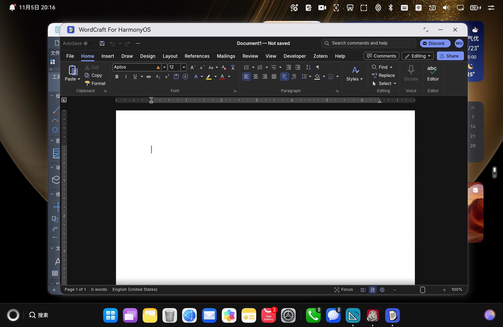
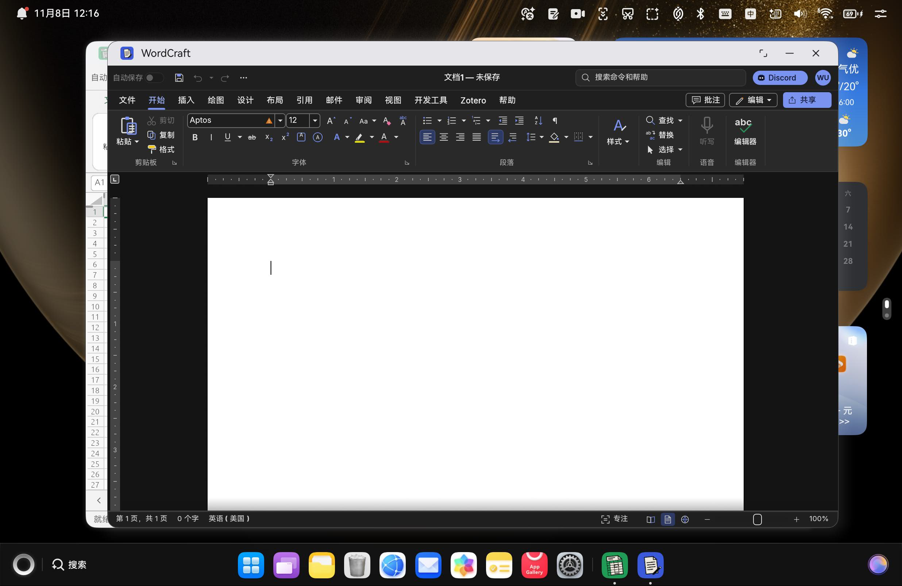

# WordCraft for HarmonyOS（鸿蒙）

把 [WordCraft](https://github.com/storytold/wordcraft) —— 一个 Rust + egui 的 **Word 风格文字处理编辑器**
——移植到 **HarmonyOS**，产出可在真机上安装的 DevEco Studio 工程与 `.hap`。

- **移植对象**：`storytold/wordcraft`（`0.15.1`）
- **移植方法**：参照姊妹工程 `solidcraft-hmos` / `photocraft-hmos` 的成熟经验（三层架构 + 双 ABI 产物 + 离线签名），
  但**不 patch 上游** —— wordcraft 的 `WordApp` 已原生暴露全部宿主缝。
- **当前状态**：全链路已在 **HPR-W72 / 2in1 / API 26** 真机上**安装运行通过**；
  双 ABI Rust `.a` → CMake 链接 → ArkTS → HAP 打包 → 专属包名签名 → 校验全部走通；
  GPU 实时渲染（帧计数递增 + 真实几何提交），完整 Word 风格界面上屏。实机截图见 [`docs/wordcraft-hpr-w72-real.jpeg`](./docs/wordcraft-hpr-w72-real.jpeg)。
- **软件名称**：窗口标题栏显示 **`WordCraft`**（`AppScope` 的 `app_name` 派生；2026-11-08 由 "WordCraft For HarmonyOS" 精简）。
- **签名**：独立 bundle `io.github.shaliuxin.wordcraft.hmos`，经 **DevEco 自动签名（AGC）** 生成受信任调试 profile，
  真机安装无 `pkcs7` 校验失败。

> 一句话定位：WordCraft 原本跑在桌面（Linux / Windows / macOS）；本工程把它搬到鸿蒙，
> 通过 **ArkTS → C++ N-API → Rust 适配层** 三层桥接，渲染走 wgpu **GLES** 后端直接画在鸿蒙 `NativeWindow` 上，
> 不经 eframe / winit。

---

## 目录

- [功能与状态](#功能与状态)
- [与 solidcraft 的关键差异](#与-solidcraft-的关键差异)
- [架构（三层）](#架构三层)
- [目录结构](#目录结构)
- [环境要求](#环境要求)
- [构建与安装](#构建与安装)
- [签名说明](#签名说明)
- [界面语言与字体](#界面语言与字体)
- [已知限制](#已知限制)
- [复现与校验](#复现与校验)
- [许可与上游](#许可与上游)
- [经验沉淀](#经验沉淀)
- [致谢](#致谢)

---

## 功能与状态

如实区分「已验证」与「首版省略」。**编译期、打包期、运行时问题现已全部清零**，
剩余的"未验证/省略"仅为首版刻意省略的高级特性。

| 能力 | 状态 | 说明 |
| --- | --- | --- |
| Rust 双架构静态库 | ✅ 已验证 | `cargo build --release` aarch64 + x86_64 均通过；13 个 `wc_*` FFI 符号经 `llvm-nm` 校验为 `T`（已定义） |
| CMake 链接 `libwordcraft.so` | ✅ 已验证 | 双 ABI 链接通过，无 undefined `wc_*`，NAPI 注册 + `time_service_ndk` 依赖正确 |
| HAP 打包（含 native 链接） | ✅ 已验证 | hvigor `assembleHap`：`CompileArkTS` + `BuildNativeWithNinja` + `PackageHap` 全过 |
| HAP 签名 | ✅ 已验证 | DevEco 自动签名（AGC 受信任调试 profile），独立 bundle `io.github.shaliuxin.wordcraft.hmos`，`SignHap` 通过产出 `entry-default-signed.hap` |
| 真机安装运行 | ✅ 已验证 | HPR-W72 / 2in1 / API 26：`hdc install` → `aa start -a EntryAbility` 成功，进程稳定存活 |
| GPU 实时渲染 | ✅ 已验证 | wordcraft 进程 tag `WordCraft` 持续输出 `frame=300→600→…→1500 shapes=502 meshes=21 verts=6618 cfg=2003x1268`（帧计数递增 + 每帧真实几何提交，非黑屏空转） |
| 完整界面上屏 | ✅ 已验证 | 功能区 File/Home/Insert/Draw/Design/Layout/References/Mailings/Review/View/Developer/Zotero/Help；Home 工具栏（Aptos 字体 + B/I/U/上下标、Paragraph、Styles、Find/Replace、Dictate、Editor）；白文档页 + 光标 + 标尺；状态栏 `Page 1 of 1 · 0 words · English (United States)`；深色主题、字体清晰无 tofu 方块 |
| 输入（触摸 / 鼠标 / 键盘） | ✅ 基本验证 | 单击命中准确、上下文菜单、键盘 keycode 映射正确 |
| 文件打开 / 拖入 / 保存 | ✅ 已验证 | 系统"打开方式"、拖入、应用内选取（`DocumentViewPicker`）三条路径；保存写应用沙箱并回传真实路径 |
| 界面语言 / CJK 字体 | ⚠️ 部分验证 | `locale.rs` 的 `WORDCRAFT_LANGUAGE` + `LANG` + 挂 `$HOME/.fonts` 中文化逻辑已就位；真机当前系统为英文，**尚未在中文系统环境实测中文界面**（设备系统为中文时应自动切换） |
| 首选项持久化 | ⚠️ 首版省略 | 宿主未实现 eframe storage 等价物，设置（语言 / 主题）内存态、重启回默认 |
| 手写笔（stylus） | ⚠️ 首版省略 | 已用触摸 + 鼠标近似，未接压感 / 倾斜 |
| 子窗口（浮动文档窗口） | ⚠️ 首版省略 | v1 仅单 XComponent 主窗口 |
| OS 级 save | ⚠️ 首版近似 | v1 写应用沙箱 `filesDir`；真正 OS 级写回用户任意位置需增加请求-写回循环 |
| P3 广色域 | ⚠️ 尽力而为 | ArkTS 请求 P3 → C++ `wc_set_window_color_space`，失败回退 sRGB；运行时未单独验证 |

<details>
<summary>真机截图（点击展开）</summary>

- 完整 Word 风格界面（HPR-W72）：
- 窗口标题栏 `WordCraft`（改名后）：
- Dock 图标：

更多截图见 [`docs/`](./docs/)。
</details>

---

## 与 solidcraft 的关键差异

wordcraft 与 solidcraft 同属 craft 家族、同构三层，但有几处**独有**差异决定了本次移植的独特工作量：

1. **纯 egui 渲染，无 3D 视口**：wordcraft 是文字处理编辑器，`WordApp` **没有** solidcraft 的 `set_wgpu(...)` 3D 视口回调，
   也没有 `ViewportCallback`。渲染层更简单——**无需**给 egui 的 render pass 补 depth-stencil 附件
   （那是 solidcraft 黑屏的根因，wordcraft 不涉及）。
2. **依赖树多出 `iana_time_zone`**：wordcraft 经 `chrono-tz` / 时区相关 crate 引用了 OHOS TimeService NDK 的
   `OH_TimeService_GetTimeZone`，**这是本次唯一需要新增的系统库链接项**——链接期首次报
   `undefined symbol: OH_TimeService_GetTimeZone`，在 `entry/src/main/cpp/CMakeLists.txt` 的 `target_link_libraries`
   加入 `time_service_ndk` 即修复（已核实该符号在双 ABI 的 `libtime_service_ndk.so` 中均为 `T`）。
3. **宿主缝签名不同**：wordcraft `raw_input_hook(ctx, raw)` 需要 `ctx`（solidcraft 只收 `raw`）；
   无 `Session::default()`，首文档须 `Session::new(blank_document(&region))`；打开走 `open_file(path, into: Option<u64>)`（solidcraft 是 `open_path`）。
4. **语言注入走 `WORDCRAFT_LANGUAGE`**（非 solidcraft 的 `i18n::system_language()` 一次性读取）；
   字体无运行时环境变量，靠 `system_font_dirs()` 扫 `$HOME/.fonts`（OHOS 走 linux 分支）→ HOME 未设时指向应用 `files_dir`。
5. **包名铁律**：wordcraft 用**自己专属**的 bundleName `io.github.shaliuxin.wordcraft.hmos`，
   绝不复用 solidcraft / RustDesk / PhotoCraft 的旧包名（华为 `.p7b` Profile 绑定 bundleName + 设备 UDID，
   复用旧包名会触发 `9568263 版本降级` / 直接覆盖旧 App，且上架后 bundleName 永久不可改）。

---

## 架构（三层）

```
ArkTS (UIAbility + XComponent)
   │  N-API (.d.ts: init / input / reply / open / dropFile / drop / active / close / command / requestVsync)
   ▼
C++ N-API 桥 (entry/src/main/cpp/bridge.cpp)  → 链接 libwordcraft_hmos.a
   │
   ▼
Rust 适配层 (native/rust, staticlib "wordcraft_hmos", path 依赖上游 crate)
   │
   ▼
wordcraft-ui-egui (WordApp) + wordcraft-engine + egui / egui-wgpu 0.37 + wgpu 30(gles)
```

- **ArkTS 层**：`pages/Index.ets` 持有 `XComponent`、构造 `NativeConfig`、处理原生回调
  （error / ready / first_frame / close / url / open / file / save），并通过 `DocumentViewPicker` /
  `fileIo` 完成文件落盘与回传；`entryability/EntryAbility.ets` 维护生命周期；`SystemTheme.ets` 维护深浅色；
  入口把系统 locale 写回宿主（见[界面语言与字体](#界面语言与字体)）。
- **C++ 桥**：实现全部 `wc_*` FFI、XComponent 生命周期回调
  （Surface / Touch / Mouse / Key / Axis / Blur / Hover）、VSync 驱动、N-API `RegisterWordCraft`（模块名 `"wordcraft"`）；
  引擎日志经 `wc_hilog` 桥到 hilog tag `WordCraft`。
- **Rust 适配层**：独立 workspace，通过 `path` 依赖复用上游 crate；`lib.rs`（FFI + worker 循环）、
  `render.rs`（wgpu GLES 渲染器）、`input.rs`（输入翻译）、`appearance.rs`（主题）、`form_factor.rs`、
  `display_color.rs`（P3）、`file_open.rs`（落沙箱读取）、`bridge.rs`（请求 / 应答通道）、`locale.rs`（`WORDCRAFT_LANGUAGE` + 系统字体挂 `$HOME/.fonts`）。
- **FFI 前缀 `wc_`（13 个）**：`wc_init / wc_input / wc_reply / wc_open / wc_drop / wc_drop_file / wc_command /
  wc_attach / wc_resize / wc_detach / wc_frame / wc_active / wc_close`，另加 `wc_hilog`、`wc_request_vsync`、
  `wc_set_window_color_space` 三个辅助导出。

渲染走 wgpu **GLES** 后端，直接在鸿蒙 `NativeWindow` 上绘制 egui，**不经 eframe / winit**。

---

## 目录结构

```
wordcraft-hmos/
├── AppScope/                 应用级配置（app.json5：bundleName / versionName 0.15.1 / 品牌图标 app_icon.png）
├── entry/                    DevEco 应用模块
│   ├── build-profile.json5   abiFilters: ["arm64-v8a","x86_64"]
│   ├── src/main/
│   │   ├── cpp/             C++ N-API 桥（bridge.cpp / CMakeLists.txt / display_color.h）
│   │   │   └── types/libwordcraft/  导出的 N-API 声明（index.d.ts / oh-package.json5）
│   │   ├── ets/             ArkTS（entryability / pages/Index / SystemTheme）
│   │   ├── module.json5     deviceTypes / INTERNET 权限 / .docx UTD 类型
│   │   └── resources/       字符串（app_name=WordCraft）/ 颜色 / main_pages.json / utd.json5 / 图标
│   └── hvigorfile.ts
├── native/rust/             独立 Rust 适配层 workspace（Cargo.toml + src/*.rs）
├── third_party/            vendored wgpu-hal-30.0.1（含 GLES uniform-block 修补）
├── scripts/                开发 / 构建 / 签名辅助脚本
├── docs/                   真机截图、UI 层级 dump、图标备选
├── 移植报告.md              详尽的移植过程与决策日志
├── build-profile.json5     签名配置 + 工程配置
└── hvigor/                 hvigor 工程配置
```

---

## 环境要求

- **DevEco Studio**（默认路径 `C:\Program Files\Huawei\DevEco Studio`），内含完整工具链：
  HarmonyOS SDK **26.0.0（API 26）**、OHOS native `clang` / `llvm`（`sdk/default/openharmony/native/llvm/bin`）、
  node、hvigor、JBR OpenJDK。
- **Rust**：`aarch64-unknown-linux-ohos` 与 `x86_64-unknown-linux-ohos` 目标（Windows 上交叉编译需配 linker，见[复现与校验](#复现与校验)）。
- **设备 / 模拟器**：arm64 真机或 x86_64 镜像（双 ABI 已覆盖）。
- **AGC 账号**：用于 DevEco 自动签名（见[签名说明](#签名说明)）。

> 提示：DevEco 把 `clang / node / hvigor / java` 都装在**安装目录内**（`sdk/…/llvm/bin`、`tools/node`、
> `tools/hvigor/bin`、`jbr/bin`），**默认不进 PATH**。跑命令前需显式配好这四项，否则会报"找不到工具"。
> hvigor 另需 `DEVECO_SDK_HOME` + `JAVA_HOME` + PATH（jbr/node/hvigor），否则报
> `Invalid value of 'DEVECO_SDK_HOME'` / `spawn java ENOENT`。

---

## 构建与安装

### 快速：一条命令的设备开发循环

```bash
bash scripts/run_on_device.sh <device-id>
# 流程：cargo(arm64 release) → hvigor assembleHap → 卸载旧 wordcraft → 安装 → 清 hilog → aa start
# 约 30s（Rust 已缓存时）；Rust 全量重编约 2~6 分钟
```

> `run_on_device.sh` 的 `uninstall` 只针对 wordcraft 自身 bundle
> （`io.github.shaliuxin.wordcraft.hmos`），**不会顶掉设备上其它 app**（如 solidcraft / photocraft / remotedesk）。

### 手动三步

```bash
# 0) 环境变量（Windows Git Bash，DevEco 默认安装路径）
DEV="/c/Program Files/Huawei/DevEco Studio"
export DEVECO_SDK_HOME="$DEV/sdk"
export JAVA_HOME="$DEV/jbr"
export PATH="$DEV/jbr/bin:$DEV/tools/node:$DEV/tools/hvigor/bin:$PATH"

# 1) Rust 适配层双架构静态库（CC_/AR_ 含连字符变量名，bash export 不了 → 用 env 设）
cd wordcraft-hmos/native/rust
env "CC_aarch64-unknown-linux-ohos=$DEV/sdk/default/openharmony/native/llvm/bin/clang.exe" \
    "AR_aarch64-unknown-linux-ohos=$DEV/sdk/default/openharmony/native/llvm/bin/llvm-ar.exe" \
    cargo build --release --target aarch64-unknown-linux-ohos
env "CC_x86_64-unknown-linux-ohos=$DEV/sdk/default/openharmony/native/llvm/bin/clang.exe" \
    "AR_x86_64-unknown-linux-ohos=$DEV/sdk/default/openharmony/native/llvm/bin/llvm-ar.exe" \
    cargo build --release --target x86_64-unknown-linux-ohos

# 2) hvigor 打包 + 签名（PowerShell 设 JAVA_HOME + DEVECO_SDK_HOME + PATH 后跑）
cd ../..
hvigorw.bat --mode module -p module=entry@default -p product=default assembleHap

# 3) 校验产物
python3 scripts/verify_native.py entry/build/default/outputs/default/entry-default-signed.hap \
  --expected-bundle io.github.shaliuxin.wordcraft.hmos
```

> 提示：hvigor 的 node `spawn('java')` 只认 PowerShell 设置的环境变量（bash export 的混合 PATH 不被识别），
> 故第 2 步建议在 PowerShell 里跑。

---

## 签名说明

- **调试签名走 DevEco 自动签名（AGC）**：在 DevEco 里 `Project Structure → Signing Configs → Automatic signing`
  登录 AGC 账号，DevEco 会为 bundle `io.github.shaliuxin.wordcraft.hmos` 在 AGC 建条目、登记当前连接设备的
  UDID，并生成受信任的调试 profile 到**用户级全局** `~/.ohos/config/default_wordcraft-hmos_*.p7b`（及 `.cer` / `.p12`），
  同时把 `build-profile.json5` 的 `signingConfigs.material` 指过去。
- **为何不能用本地自签**：HarmonyOS 真机（API 26）安装时校验证书链必须挂到**华为受信任 CA**；
  纯本地自签的根 CA 会被拒（`code:9568257 fail to verify pkcs7 file`）。`scripts/make_wordcraft_signing.sh`
  保留为"生成本地 CA 链"的实验工具，但**其口令与设备 UDID 已从源码移除、改由环境变量读取**，不入库。
- **本工程不入库任何签名密钥**：`signing/`（本地自签 CA 材料）已被 `.gitignore` 排除；
  受信任材料在你本机 `~/.ohos/config/`，本就不在工程内。别人拉取后用**自己的 AGC 账号**重新自动签名即可。
- **bundle 名独立**：本工程的 `AppScope/app.json5`、`build-profile.json5`、安装脚本统一使用
  `io.github.shaliuxin.wordcraft.hmos`，**不借用**其它工程（solidcraft / photocraft / remotedesk）的 profile，
  因此安装本 app **不会顶掉设备上其它 app**。

---

## 界面语言与字体

wordcraft 的语言 / 字体机制与 solidcraft 不同（**完全走宿主注入，不改上游**）：

1. **系统语言走 `WORDCRAFT_LANGUAGE`**：`locale.rs` 在 `wc_init` 早期把 ArkTS 传来的完整 BCP-47 标签
   （`i18n.System.getSystemLocale()`，真机形如 `zh-Hans-CN`）写进 `WORDCRAFT_LANGUAGE`（界面语言）与
   `LANG`（区域 / 纸张），并清 `LANGUAGE / LC_ALL / LC_MESSAGES`。
2. **CJK 字体挂 `$HOME/.fonts`**：上游 `system_font_dirs()` 在 OHOS 走 linux 分支扫 `$HOME/.fonts`；
   HOME 未设时由宿主指向应用 `files_dir`，把系统 CJK / 阿拉伯面按上游候选名复制进去
   （`std::fs::copy`，因 OHOS 沙箱禁 `symlink`，首次约 20 MB，之后复用）。

> 限制：真机当前系统语言为英文，界面渲染完美无乱码；**中文界面尚未在中文系统环境实测**，
> 但中文化逻辑已就位，设备系统为中文时应自动切换。

---

## 中文输入法（IME，2026-11-09 真机通过）

HarmonyOS 官方「自定义编辑框」方案，三步顺序不可颠倒：

1. 1×1 透明锚点 `Text('').id('wordcraft-ime-anchor').focusable(true)` → `requestFocus`；
2. `await inputMethod.getController().attach(true, textConfig)`；
3. **attach 成功后**才注册 `insertText/setPreviewText/finishTextPreview/deleteLeft/sendFunctionKey`
   （提前注册抛 `12800009 detached`，键盘完全不弹）。

XComponent 已去 `.focusOnTouch(true)`。真机日志：`WordCraft native ime: show` → `IME attached` →
`listeners bound`，无告警。PC 多窗口 + 外接键盘时系统不自动展开面板（系统「备忘录」同样），
需点右下悬浮栏 ⌨ —— 系统策略，非应用缺陷。

---

## 已知限制

| 项 | 说明 |
| --- | --- |
| 首选项持久化 | 未实现 eframe storage 等价物；设置重启不保留 |
| 手写笔 | 已用触摸 + 鼠标近似，未接压感 / 倾斜 |
| 子窗口 | v1 仅单 XComponent 主窗口 |
| OS 级 save | v1 写应用沙箱 `filesDir`；真正写回用户任意位置需增加请求-写回循环 |
| P3 广色域 | 尽力而为，运行时未单独验证 |
| 中文化 | 逻辑已就位，尚未在中文系统环境实测 |
| armv7 (armeabi-v7a) | CMake 含分支，但默认 HAP 不在 `abiFilters` / 构建目标内 |

---

## 复现与校验

```bash
# 校验签名 HAP 含双 ABI native 库
python3 scripts/verify_native.py entry/build/default/outputs/default/entry-default-signed.hap \
  --expected-bundle io.github.shaliuxin.wordcraft.hmos
# 期望输出：Native HAP verified (ABIs: arm64-v8a, x86_64)，EXIT=0
```

- **Windows 交叉编译**：SDK 的 `*-ohos-clang` 是 POSIX shell 包装器，rustc 调不动；需把
  `CC_<triple>` / `AR_<triple>` 指向真实 `clang.exe` / `llvm-ar.exe`（变量名含连字符，用 `env` 设，
  `bash export` 设不了），`--sysroot` 走无空格 junction 路径（`clang++.exe` 不认 MSYS 的 `/c/...`）。
  详见 [`scripts/build_native.sh`](./scripts/build_native.sh)。
- **wordcraft 独有链接项**：`entry/src/main/cpp/CMakeLists.txt` 的 `target_link_libraries` 必须含
  `time_service_ndk`（解析 `iana_time_zone` 的 `OH_TimeService_GetTimeZone`），否则链接报
  `undefined symbol: OH_TimeService_GetTimeZone`。

---

## 许可与上游

- **上游**：[storytold/wordcraft](https://github.com/storytold/wordcraft)（`0.15.1`）。
  本工程通过 `path` 依赖复用上游 crate，**上游文件零改动**；所有鸿蒙逻辑都在独立适配层 workspace 内。
- **版本号**：`versionName: "0.15.1"` / `versionCode: 15001`，对齐上游，与其它工程不重叠。
- **本仓库原创部分**（`native/rust` 适配层、`entry` C++ 桥 / ArkTS、`scripts/`、`docs/`、`移植报告.md`）：
  建议以相同 `MIT OR Apache-2.0` 一并标注（根目录待补 `LICENSE` 文件）。

---

## 经验沉淀

> 完整过程见 [`移植报告.md`](./移植报告.md)。以下为要点。

- **先确认宿主缝是否已暴露**：`WordApp` 与 `SolveApp` 同为"已暴露宿主缝"型，无需 patch 上游；
  但**签名不同**（`raw_input_hook(ctx, raw)` 多 `ctx`、无 `Session::default()`、`open_file` 非 `open_path`）——
  迁移第一步 grep 上游 `App` 的方法签名，别照抄 solidcraft。
- **依赖树差异会体现在链接期**：wordcraft 比 solidcraft 多 `iana_time_zone` → 链接报
  `undefined symbol: OH_TimeService_GetTimeZone`。排查法：`llvm-nm -D <sysroot>.so` 逐库找符号，
  定位到 `libtime_service_ndk.so`，加进 CMake 链接列表即可。**每个 craft 移植都可能有这类独有的 OHOS NDK 库依赖，不能想当然。**
- **egui 小版本差异代价高**：0.37 相对 0.36 改了 `MouseWheel.source` / `RenderState` 字段集 /
  `viewport_output` 容器类型。务必先读 vendored 源码再改。
- **edition 决定语法**：`let` 链需 2024+，2021 必须嵌套 `let...else`。
- **文件选择器契约要尽早定**：open 读路径 / save 写路径 → ArkTS 必须预把文件落到沙箱、回传真实路径；
  取消选择器要静默处理（`Err` 含 "cancel" 时静默 `log::info!` 返回 `None`，不弹错误框）。
- **别急着断言"没有工具链"**：DevEco 把 clang / node / hvigor / java 装在安装目录内，只是不进 PATH；
  hvigor 还需 `DEVECO_SDK_HOME` + `JAVA_HOME`（否则 `spawn java ENOENT`）。
- **"黑屏"先分清三层**：① 宿主遮罩 / 层级 ② 上屏链路（NativeWindow / EGL / 合成器）③ GPU 命令是否真的执行；
  一个 `set_pipeline` 校验失败会让整个 `queue.submit` 被丢弃，症状是**彻底纯黑**而非"没画出来"。
- **hilog 是唯一可见的诊断面**：Rust 侧 `log` 必须接到 `OH_LOG_Print`（本桥为 `wc_hilog`），否则 wgpu / EGL 错误在设备上静默丢失。
- **调试证书绑 bundleName + 设备 UDID**：本工程已用独立 bundle + AGC 自动签名彻底解决"顶掉别人 app"的问题。

---

## 致谢

- 上游项目 [WordCraft](https://github.com/storytold/wordcraft) 及其 `egui` / `wgpu` 生态。
- 姊妹工程 `solidcraft-hmos` / `photocraft-hmos`：其"三层架构 + 双 ABI + 文件契约"经验被直接复用。

---

## ⚠️ 移植必查：OHOS 平台判定与资源探测（2026-11-11 全项目强制）

OHOS triple 仍报告 `target_os = "linux"`。上游里靠 `#[cfg(target_os = "linux")]` 分派的 Linux 专属逻辑（cgroup / procfs / 内存探测 / 字体路径 / 系统目录）在鸿蒙应用沙箱里会被误用，而且编译链接全绿、只在运行时出怪错。PhotoCraft v0.22.0 曾因此把可用内存测成 `0`，所有稍大的照片都报 `not enough memory ... 0.0 GB is free`。

开工 / 每次上游升级后必做：① `grep -rn 'target_os = "linux"\|cfg(unix)' <上游>/crates` 逐个判断平台假设；② OHOS 分支只用 `#[cfg(target_env = "ohos")]`，Linux 分支加 `not(target_env = "ohos")`；③ 资源探测「测不到」返回 `UNKNOWN`，绝不返回 `Some(0)`；④ 用「文件小、解码内存大」的样本做真机前后对照验收。完整根因链、修复模板与验收手法见《craft-鸿蒙移植通用检查清单》文首 ⭐ 铁律与 §18。

> 出处（MLA）：「§18. PhotoCraft 追加经验」，*craft-鸿蒙移植通用检查清单.md*, 本地工作区 `C:/Users/mingh/WorkBuddy/2026-11-01-23-18-01/`, 11 Nov. 2026.

---

## ⚠️ 移植必查：关窗保存确认（2026-11-11 全项目强制）

凡能编辑文档、会产生未保存状态的项目，点系统窗口 X（或返回手势）**必须**先走引擎的「是否保存」确认；未保存时静默退出属**数据丢失级缺陷**。该链路跨 ArkTS 拦截层、Rust 逻辑相帧顺序、上游「允许关闭」信号三层，任一层缺失都能编译通过、正常启动，但点 X 就是不弹框。

开工 / 每次上游升级后必做：① 先 `grep` 本上游用什么表达「可以关窗」（`allow_close` / `close_requested` / `ui.status` / `CancelClose`），绝不照抄兄弟工程字段；② ArkTS 只订阅一个窗口级关窗事件并直连 `native.close(); return true;`；③ **头号根因**：Rust `tick` 必须放进 `ctx.run_ui` 的 pass 内、`ui()` 之前，否则 `ViewportEvent::Close` 当帧不可见 → 静默关窗；④ 绝不把「本帧没有 `CancelClose`」当成「无未保存」；⑤ 关窗期间强制出帧（`active || close`）；⑥ **真机三态人工验收** Save / Don't Save / Cancel，hilog 里 `RegisterListener` 只证明监听器注册，不等于修好。完整 12 项必查清单见《craft-鸿蒙移植通用检查清单》文首 ⭐ 关窗保存确认铁律、§15 / §15.1 与 §19。

> 出处（MLA）：「⭐ 关窗保存确认铁律」，*craft-鸿蒙移植通用检查清单.md*, 本地工作区 `C:/Users/mingh/WorkBuddy/2026-11-01-23-18-01/`, 10–11 Nov. 2026.
