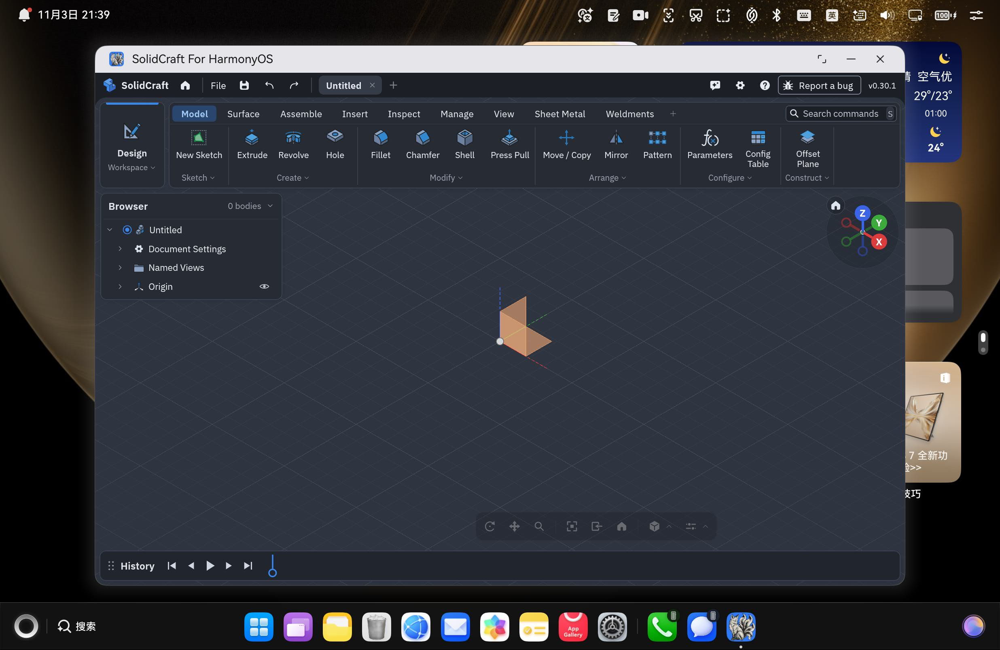
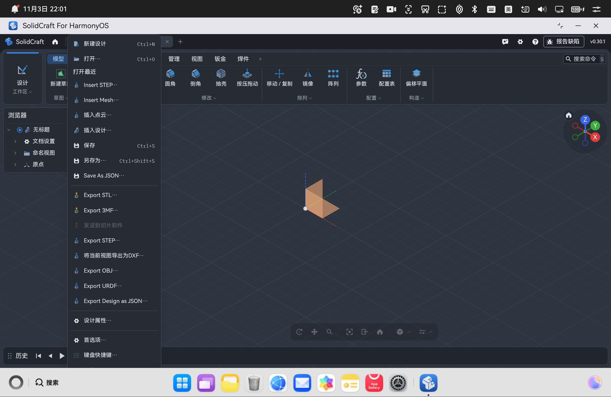
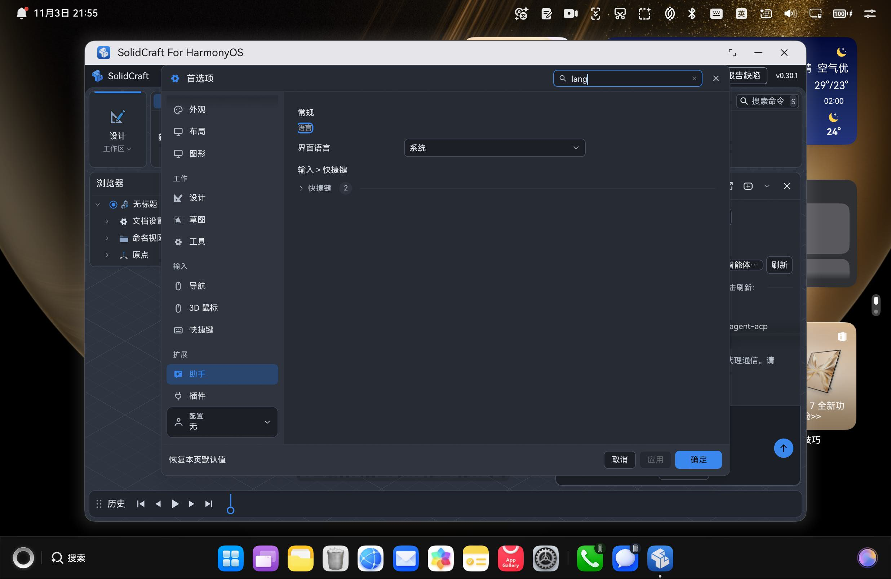
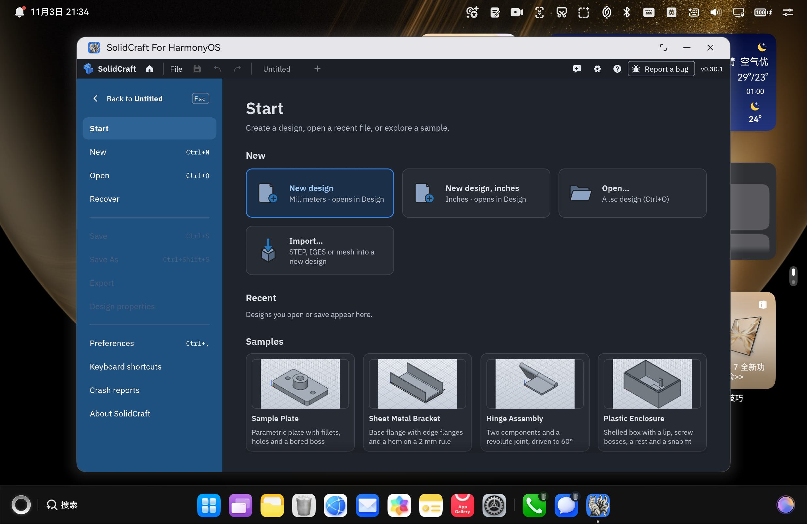

# SolidCraft for HarmonyOS（鸿蒙）

把 [SolidCraft](https://github.com/tangency-labs/solidcraft) —— 一个 Rust + egui 的 CAD / B-rep（边界表示）内核
——移植到 **HarmonyOS**，产出可在真机上安装的 DevEco Studio 工程与 `.hap`。

- **移植对象**：`tangency-labs/solidcraft`（`0.30.1`）
- **移植方法**：参照姊妹工程 `photocraft-hmos` 的成熟经验（三层架构 + 双 ABI 产物 + 离线签名），
  但**不 patch 上游** —— SolidCraft 的 `SolveApp` 已原生暴露全部宿主缝。
- **当前状态**：已在 **HUAWEI MateBook Fold / 2in1 / API 26 / Maleoon 916** 真机上**安装运行通过**；
  完整界面上屏、输入可用、`.step`（如"人形战戟.step"）加载正常、界面语言自动跟随系统。
- **签名**：独立 bundle `io.github.shaliuxin.solidcraft.hmos`，经 **DevEco 自动签名（AGC）** 生成受信任调试 profile，
  真机安装无 `pkcs7` 校验失败。

> 一句话定位：SolidCraft 原本跑在桌面（Linux / Windows / macOS）；本工程把它搬到鸿蒙，
> 通过 **ArkTS → C++ N-API → Rust 适配层** 三层桥接，渲染走 wgpu **GLES** 后端直接画在鸿蒙 `NativeWindow` 上。

---

## 目录

- [功能与状态](#功能与状态)
- [架构（三层）](#架构三层)
- [目录结构](#目录结构)
- [环境要求](#环境要求)
- [构建与安装](#构建与安装)
- [签名说明](#签名说明)
- [界面语言与字体](#界面语言与字体)
- [已知限制](#已知限制)
- [复现与校验](#复现与校验)
- [许可与上游](#许可与上游)
- [经验沉淀](#经验沉淀)
- [致谢](#致谢)

---

## 功能与状态

如实区分「已验证」与「刻意省略」。**编译期、打包期、运行时问题现已全部清零**，
剩余的"未验证"仅为首版刻意省略的高级特性。

| 能力 | 状态 | 说明 |
| --- | --- | --- |
| Rust 双架构静态库 | ✅ 已验证 | `cargo build --release` arm64 + x86_64 均通过，ELF 架构与 `sc_*` FFI 符号校验通过 |
| HAP 打包（含 native 链接） | ✅ 已验证 | hvigor `assembleHap`：`CompileArkTS` + `BuildNativeWithNinja` + `PackageHap` 全过 |
| HAP 签名 | ✅ 已验证 | DevEco 自动签名（AGC 受信任调试 profile），独立 bundle `io.github.shaliuxin.solidcraft.hmos` |
| 真机安装运行 | ✅ 已验证 | HUAWEI MateBook Fold / 2in1 / API 26 / Maleoon 916：安装启动成功，完整界面（ribbon 工具栏 / Browser / 3D 视口 / History 时间轴 / Start 页与示例缩略图）渲染 |
| 空闲自动休眠 | ✅ 已验证 | 按 `repaint_delay` 排帧，静止后帧循环真正停下（不再 58fps 空转），点击立即恢复 |
| 输入（触摸 / 鼠标 / 键盘） | ✅ 基本验证 | 单击命中准确、长按弹上下文菜单、键盘 keycode 映射正确（`2070=Escape`、`2071=ForwardDel`） |
| `.step` 模型加载 | ✅ 已验证 | SMLib（NVIDIA B-rep C++ 内核）经 DevEco `clang++` 交叉编译到 aarch64-ohos 并静态链入 `libsolidcraft.so`；"人形战戟.step" 打开成功 |
| 界面语言跟随系统 | ✅ 已验证 | 系统 `zh-Hans-CN` → 界面自动中文，设置里显示「系统」；CJK 字体由 `/system/fonts` 注入 |
| 首选项持久化 | ⚠️ 首版省略 | 宿主未实现 eframe storage 等价物，设置（语言 / 主题）内存态、重启不保留 |
| 手写笔（stylus） | ⚠️ 首版省略 | 已用触摸 + 鼠标近似，未接压感 / 倾斜 |
| 子窗口（浮动文档窗口） | ⚠️ 首版省略 | v1 仅单 XComponent 主窗口 |
| OS 级 save | ⚠️ 首版近似 | v1 写应用沙箱 `filesDir`；真正 OS 级写回应增加请求-写回循环 |
| P3 广色域 | ⚠️ 尽力而为 | ArkTS 请求 P3、C++ 调 `sc_set_window_color_space`，失败回退 sRGB |

<details>
<summary>真机截图（点击展开）</summary>

- 首帧上屏：
- 中文界面与文件菜单：
- 界面语言跟随系统：
- File 菜单与 Start 页：
- Dock 图标：

更多截图见 [`docs/`](./docs/)。
</details>

---

## 架构（三层）

```
ArkTS (UIAbility + XComponent)
   │  N-API (.d.ts: init / input / reply / open / drop / active / close / command)
   ▼
C++ N-API 桥 (entry/src/main/cpp/bridge.cpp)  → 链接 libsolidcraft_hmos.a
   │
   ▼
Rust 适配层 (native/rust, staticlib "solidcraft_hmos", path 依赖上游 crate)
   │
   ▼
solidcraft-ui-egui (SolveApp) + solidcraft-engine + egui / egui-wgpu / wgpu(GLES)
```

- **ArkTS 层**：`Index.ets` 持有 `XComponent`、构造 `NativeConfig`、处理原生回调
  （error / ready / first_frame / close / url / open / file / save），并通过 `DocumentViewPicker` /
  `fileIo` 完成文件落盘与回传；`SystemTheme.ets` 维护深浅色；入口把系统 locale 写回宿主（见[界面语言与字体](#界面语言与字体)）。
- **C++ 桥**：实现全部 `sc_*` FFI、XComponent 生命周期回调
  （Surface / Touch / Mouse / Key / Axis / Blur / Hover）、VSync 驱动、N-API `Init` 注册；
  引擎日志经 `sc_hilog` 桥到 hilog tag `SolidCraftGL`。
- **Rust 适配层**：独立 workspace，通过 `path` 依赖复用上游 crate；含 `lib.rs`（FFI + worker 循环）、
  `render.rs`（wgpu GLES 渲染器）、`input.rs`（输入翻译）、`appearance.rs`（主题）、`form_factor.rs`、
  `display_color.rs`（P3）、`file_open.rs`（fd 复制 / 读取）、`bridge.rs`（请求 / 应答通道）、`locale.rs`（系统语言与字体桥接）。

渲染走 wgpu **GLES** 后端，直接在鸿蒙 `NativeWindow` 上绘制 egui，**不经 eframe / winit**。

---

## 目录结构

```
solidcraft-hmos/
├── AppScope/                 应用级配置（app.json5、品牌图标 app_icon.png）
├── entry/                    DevEco 应用模块
│   ├── build-profile.json5   abiFilters: ["arm64-v8a","x86_64"]
│   ├── src/main/
│   │   ├── cpp/             C++ N-API 桥（bridge.cpp / CMakeLists.txt / display_color.h）
│   │   │   └── types/libsolidcraft/  导出的 N-API 声明（index.d.ts / oh-package.json5）
│   │   ├── ets/             ArkTS（entryability / pages/Index / SystemTheme）
│   │   ├── module.json5     deviceTypes / INTERNET 权限 / .solidcraft UTD 类型
│   │   └── resources/       字符串 / 颜色 / main_pages.json / utd.json5 / 图标
│   └── hvigorfile.ts
├── native/rust/             独立 Rust 适配层 workspace（Cargo.toml + src/*.rs）
├── third_party/            vendored wgpu-hal-30.0.1（含 GLES uniform-block 修补）
├── scripts/                开发 / 构建 / 签名辅助脚本
├── docs/                   真机截图、图标备选
├── 移植报告.md              详尽的移植过程与决策日志（271 行）
├── build-profile.json5     签名配置 + 工程配置（modelVersion 26.0.0）
└── hvigor/                 hvigor 工程配置
```

---

## 环境要求

- **DevEco Studio**（默认路径 `C:\Program Files\Huawei\DevEco Studio`），内含完整工具链：
  HarmonyOS SDK **26.0.0（API 26）**、OHOS native `clang` / `llvm`（`sdk/default/openharmony/native/llvm/bin`）、
  node、hvigor、JBR OpenJDK。
- **Rust**：`aarch64-unknown-linux-ohos` 与 `x86_64-unknown-linux-ohos` 目标（Windows 上需配 `native/rust/.cargo/config.toml` 的 linker，见[复现与校验](#复现与校验)）。
- **设备 / 模拟器**：arm64 真机或 x86_64 镜像（双 ABI 已覆盖）。
- **AGC 账号**：用于 DevEco 自动签名（见[签名说明](#签名说明)）。

> 提示：DevEco 把 `clang / node / hvigor / java` 都装在**安装目录内**（`sdk/…/llvm/bin`、`tools/node`、
> `tools/hvigor/bin`、`jbr/bin`），**默认不进 PATH**。跑命令前需显式配好这四项，否则会报"找不到工具"。

---

## 构建与安装

### 快速：一条命令的设备开发循环

```bash
bash scripts/run_on_device.sh <device-id>
# 流程：cargo(arm64 release) → hvigor assembleHap → 卸载旧 solidcraft → 安装 → 清 hilog → aa start
# 约 30s（Rust 已缓存时）；Rust 全量重编约 3~6 分钟
```

> `run_on_device.sh` 的 `uninstall` 只针对 solidcraft 自身 bundle
> （`io.github.shaliuxin.solidcraft.hmos`），**不会顶掉设备上其它 app**（如 photocraft / remotedesk）。

### 手动三步

```bash
# 0) 环境变量（Windows Git Bash，DevEco 默认安装路径）
DEVECO="/c/Program Files/Huawei/DevEco Studio"
export DEVECO_SDK_HOME="$DEVECO/sdk"
export JAVA_HOME="$DEVECO/jbr"
export PATH="$DEVECO/jbr/bin:$DEVECO/tools/node:$DEVECO/tools/hvigor/bin:$PATH"

# 1) Rust 适配层双架构静态库
cd solidcraft-hmos/native/rust
SDKLLVM="$DEVECO/sdk/default/openharmony/native/llvm/bin"
CC_aarch64_unknown_linux_ohos="$SDKLLVM/clang.exe" AR_aarch64_unknown_linux_ohos="$SDKLLVM/llvm-ar.exe" \
  cargo build --release --target aarch64-unknown-linux-ohos
CC_x86_64_unknown_linux_ohos="$SDKLLVM/clang.exe" AR_x86_64_unknown_linux_ohos="$SDKLLVM/llvm-ar.exe" \
  cargo build --release --target x86_64-unknown-linux-ohos

# 2) hvigor 打包 + 签名
cd ../..
node "$DEVECO/tools/hvigor/bin/hvigorw.js" --sync -p product=default --no-daemon
node "$DEVECO/tools/hvigor/bin/hvigorw.js" assembleHap --mode module -p product=default -p buildMode=debug --no-daemon

# 3) 校验产物
python3 scripts/verify_native.py entry/build/default/outputs/default/entry-default-signed.hap \
  --expected-bundle io.github.shaliuxin.solidcraft.hmos
```

---

## 签名说明

- **调试签名走 DevEco 自动签名（AGC）**：在 DevEco 里 `Project Structure → Signing Configs → Automatic signing`
  登录 AGC 账号，DevEco 会为 bundle `io.github.shaliuxin.solidcraft.hmos` 在 AGC 建条目、登记当前连接设备的
  UDID，并生成受信任的调试 profile 到**用户级全局** `~/.ohos/config/default_solidcraft-hmos_*.p7b`（及 `.cer` / `.p12`），
  同时把 `build-profile.json5` 的 `signingConfigs.material` 指过去。
- **为何不能用本地自签**：HarmonyOS 真机（API 26）安装时校验证书链必须挂到**华为受信任 CA**；
  纯本地自签的根 CA 会被拒（`code:9568257 fail to verify pkcs7 file`）。`scripts/make_solidcraft_signing.sh`
  保留为"生成本地 CA 链"的实验工具，但**其口令与设备 UDID 已从源码移除、改由环境变量读取**，不入库。
- **本工程不入库任何签名密钥**：`signing/`（本地自签 CA 材料）已被 `.gitignore` 排除；
  受信任材料在你本机 `~/.ohos/config/`，本就不在工程内。别人拉取后用**自己的 AGC 账号**重新自动签名即可。
- **bundle 名独立**：本工程的 `AppScope/app.json5`、`build-profile.json5`、安装脚本统一使用
  `io.github.shaliuxin.solidcraft.hmos`，**不借用**其它工程（photocraft / remotedesk）的 profile，
  因此安装本 app **不会顶掉设备上其它 app**。

---

## 界面语言与字体

首版装到真机后界面是英文、且语言列表里的中文项显示成方块。两个独立原因，均已修复（**完全走宿主注入，不改上游**）：

1. **系统语言读不到**：上游 `sys-locale` 在 unix 上只看 `LANGUAGE` / `LC_ALL` / `LC_MESSAGES` / `LANG` 环境变量，
   而鸿蒙应用进程不带这些变量 → `"system"` 永远解析成英文。
   修复：ArkTS 用 `i18n.System.getSystemLocale()` 取完整 BCP-47 标签（真机为 `zh-Hans-CN`）随 `NativeConfig`
   传给 Rust；`sc_init` 里、任何一次性求值之前把标签写进 `LANG`（`i18n::system_language()` 是进程级 `OnceLock`，
   第一次读到什么就固定，故必须先写环境变量再让它求值）。
2. **没有 CJK 字体**：上游 `system_fallbacks()` 只扫桌面字体路径，命不中鸿蒙的 `/system/fonts/HarmonyOS_Sans_SC.ttf`。
   修复：把 `/system/fonts/HarmonyOS_Sans_{SC,TC}.ttf` 复制进沙箱 `filesDir/system-fonts` 并**按上游认得的文件名**命名
   （`NotoSansCJK-Regular.ttc` 同时补 CJK 与中文槽；`NotoSansArabic-Regular.ttf` 补阿拉伯语槽）；
   两个环境变量 `SOLIDCRAFT_FONT_DIRS` / `CRAFT_FONTS_DIR` 指向该目录。
   鸿蒙沙箱禁止建软链（`symlink` 返回 EACCES），故退回 `std::fs::copy`（首次约 20 MB，之后复用）。

> 限制：`system_language()` 在进程内只解析一次，**运行中切换系统语言需重新打开应用**（与上游桌面版一致）。

---

## 已知限制

| 项 | 说明 |
| --- | --- |
| 首选项持久化 | 未实现 eframe storage 等价物；设置重启不保留（`language` 因此恒为 `system`，恰好符合"自动适配"语义） |
| 手写笔 | 已用触摸 + 鼠标近似，未接压感 / 倾斜 |
| 子窗口 | v1 仅单 XComponent 主窗口 |
| OS 级 save | v1 写应用沙箱 `filesDir`；真正写回用户任意位置需增加请求-写回循环 |
| P3 广色域 | 尽力而为，运行时未单独验证 |
| armv7 (armeabi-v7a) | CMake 含分支，但默认 HAP 不在 `abiFilters` / 构建目标内 |

---

## 复现与校验

```bash
# 校验签名 HAP 含双 ABI native 库
python3 scripts/verify_native.py entry/build/default/outputs/default/entry-default-signed.hap \
  --expected-bundle io.github.shaliuxin.solidcraft.hmos
# 期望输出：Native HAP verified (ABIs: arm64-v8a, x86_64)，EXIT=0
```

- **Windows 交叉链接配置**（`native/rust/.cargo/config.toml`）：SDK 的 `*-ohos-clang` 是 POSIX shell 包装器，
  rustc 调不动；需指向 `clang.exe` 并用 `-C link-arg=--target/--sysroot`（旧 rustc 不认 `-C target-flag`）：

  ```toml
  [target.aarch64-unknown-linux-ohos]
  linker = "C:/Program Files/Huawei/DevEco Studio/sdk/default/openharmony/native/llvm/bin/clang.exe"
  rustflags = ["-C", "link-arg=--target=aarch64-linux-ohos",
                     "-C", "link-arg=--sysroot=C:/Program Files/Huawei/DevEco Studio/sdk/default/openharmony/native/sysroot"]
  # x86_64 同理，triple 为 x86_64-linux-ohos
  ```

- **SMLib 交叉编译**：`scripts/run_on_device.sh` 已内置 `CXXFLAGS` 把 `--sysroot` 指向无空格 junction
  `C:\ohossysroot`（`clang++.exe` 是原生 Windows 可执行文件，不认 MSYS 的 `/c/...` 路径，须用原生反斜杠路径），
  编出的 SMLib 符号静态链入 `libsolidcraft.so`，并同目录捆绑 `libc++_shared.so`。

---

## 许可与上游

- **上游**：[tangency-labs/solidcraft](https://github.com/tangency-labs/solidcraft)（`0.30.1`）。
  本工程通过 `path` 依赖复用上游 crate，**上游文件零改动**；所有鸿蒙逻辑都在独立适配层 workspace 内。
- **版本号**：`versionName: "0.30.1"` / `versionCode: 30001`，对齐上游，与其它工程（photocraft 的 `0.1.0.1 / 10001`）不重叠。
- **上游许可**：[SolidCraft](https://github.com/tangency-labs/solidcraft) 为 `MIT OR Apache-2.0`，
  本工程通过 `path` 依赖复用其 crate，遵循同一许可。
- **本仓库原创部分**（`native/rust` 适配层、`entry` C++ 桥 / ArkTS、`scripts/`、`docs/`、`移植报告.md`）：
  建议以相同 `MIT OR Apache-2.0` 一并标注（根目录待补 `LICENSE` 文件）。

---

## 经验沉淀

> 完整过程见 [`移植报告.md`](./移植报告.md)。以下为要点。

- **先确认宿主缝是否已暴露**：迁移新上游第一步应 grep 其 `App` / `Session` 是否已有
  `logic / raw_input_hook / ui / open_path / set_wgpu` 缝；有则零 patch。
- **egui 小版本差异代价高**：0.36.2 改了 `FullOutput` / `MouseWheel` / `system_theme` / `RenderState`，
  务必先读 vendored 源码再改。
- **edition 决定语法**：`let` 链需 2024+，2021 必须嵌套 `let...else`。
- **文件选择器契约要尽早定**：open 读路径 / save 写路径 → ArkTS 必须预把文件落到沙箱、回传真实路径。
- **别急着断言"没有工具链"**：DevEco 把 clang / node / hvigor / java 装在安装目录内，只是不进 PATH。
- **"黑屏"先分清三层**：① 宿主遮罩 / 层级 ② 上屏链路（NativeWindow / EGL / 合成器）③ GPU 命令是否真的执行；
  一个 `set_pipeline` 校验失败会让整个 `queue.submit` 被丢弃，症状是**彻底纯黑**而非"3D 没画出来"。
- **hilog 是唯一可见的诊断面**：Rust 侧 `log` 必须接到 `OH_LOG_Print`，否则 wgpu / EGL 错误在设备上静默丢失。
- **调试证书绑 bundleName + 设备 UDID**：本工程已用独立 bundle + AGC 自动签名彻底解决"顶掉别人 app"的问题。

---

## 致谢

- 上游项目 [SolidCraft](https://github.com/tangency-labs/solidcraft) 及其 `egui` / `wgpu` 生态。
- 姊妹工程 `photocraft-hmos`：其"三层架构 + 双 ABI + 文件契约"经验被直接复用。
